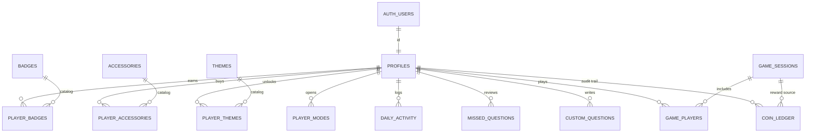

# Revuzz database model

PostgreSQL (Supabase). `auth.users` is managed by Supabase Auth; everything else
lives in `public`.

## ER diagram

## Data dictionary

### `profiles` — one row per player

| Column | Type | Notes |
|---|---|---|
| `id` | uuid PK | references `auth.users(id)`, `on delete cascade` |
| `student_number` | text unique | 6–15 digits, immutable for students |
| `username` | text | 3–16 letters/numbers/_, unique ignoring case |
| `first_name`, `middle_name`, `last_name` | text | separate so reports can sort by surname |
| `email` | text | contact only; never used as the login name |
| `grade`, `strand`, `school_year` | text | e.g. `12`, `STEM`, `2026–2027` |
| `role` | text | `student` or `admin`; a trigger blocks self-promotion |
| `avatar` | jsonb | `{c,e,h,g,x}` slots for the SVG avatar |
| `xp`, `level`, `coins` | integer | level 1+, never negative. **Server-owned** - only the reward RPCs write these |
| `active_theme` | text FK | → `themes.id` |
| `streak`, `last_played_on` | integer, date | consecutive-day streak |
| `total_correct` | integer | lifetime correct answers (server-owned, accumulated by `revuzz_record_game`) |
| `last_result` | jsonb | `{mode,pos,pts}` of the latest match |
| `inventory` | jsonb | lifelines `{f,t,s}` |
| `preferences` | jsonb | `{noVib,ts,rm,hc}` |
| `tour_done` | boolean | guided tour finished |
| `created_at`, `updated_at` | timestamptz | `updated_at` set by trigger |

### Unlock tables

| Table | Key | Extra columns |
|---|---|---|
| `player_badges` | (`user_id`, `badge_id`) | `earned_at` |
| `player_accessories` | (`user_id`, `accessory_key`) | `price_paid`, `acquired_at` |
| `player_themes` | (`user_id`, `theme_id`) | `acquired_at` |
| `player_modes` | (`user_id`, `mode`) | `first_seen_at` |

### `daily_activity` — one row per player per day

`(user_id, activity_date)` PK, `correct_count`, `quest_completed`,
`coins_awarded`, `spun`. This is what makes the streak and the “10 correct
today” quest survive a device change, and it keeps a history instead of only
today's number. `activity_date` is the **Philippine** date (`revuzz_today()`),
not UTC: the school day ends at midnight in Manila, so a 7 a.m. student gets a
fresh quest instead of yesterday's.

**Server-owned.** The browser can only read it. `revuzz_record_game` adds the
answers and flips `quest_completed` when the day reaches 10; `revuzz_claim_daily`
sets `spun` and pays the wheel. A client-supplied count is ignored, so the quest
bonus cannot be claimed by editing a request.

### `missed_questions` — review deck

`(user_id, prompt)` unique, full question JSON, `times_missed`, `last_missed_at`.
The flashcard “Missed” tab reads this list.

### `custom_questions` — the player's quiz maker

`type` (`mc`/`tf`/`id`/`en`), `prompt`, `choices` jsonb for multiple choice,
`answer` jsonb (boolean, array, or `null` for multiple choice where `choices[0]`
is the key), `position`. The save function caps the set at 40.

### `game_sessions` and `game_players` — match history

`game_sessions`: `code`, `mode`, `question_types[]`, `host_id`, `started_at`,
`ended_at`.

`game_players`: one row per participant per match — `name`, `avatar`, `score`,
`rank`, `won`, `correct`, `wrong`, `attempts`, `xp_gained`, `coins_gained`,
`team`, `is_bot`. A partial unique index stops the same player from being
recorded twice in one match. Bots have `user_id = null`.

### `coin_ledger` — audit trail

`amount`, `reason` (e.g. `game_reward`), `ref_id` (the match), `created_at`.
Coins themselves are the balance in `profiles`; the ledger explains how the
balance moved.

### `lessons` — a student's own handouts

`title`, `source_name`, `source_kind` (`txt`/`md`/`pdf`/`docx`/`pptx`/`paste`),
`body` (20–120,000 characters), `chars`, optional `summary`, timestamps. The
text is extracted **on the device**; only the text is stored. RLS is owner-only
in both directions — there is deliberately no teacher/admin read policy, so a
handout can never be opened from another account.

### `ai_usage` — the AI quota counter

`(user_id, usage_date)` primary key, `calls`, `questions`. One row per student
per Manila day. RLS is on with **zero policies and no browser grant**: the
numbers are only reachable through `revuzz_ai_reserve`, `revuzz_ai_quota`,
`revuzz_ai_class_used` (and `revuzz_ai_refund` from the service role).

### Catalogs

`themes(id, name, price)`, `badges(id, name, icon, description, sort_order)`,
`accessories(key, category, slot, price)`.

## Views

- **`leaderboard`** — one row per student: `name`, `avatar`, `lvl`, `xp`,
  `coins`, `grade`, `strand`, `games`, `wins`, `score` (best match), `last_played`,
  `mode`, `bd` (badge ids). Defined with `security_invoker = false` so it can
  read across players while exposing only public columns.
- **`public_profiles`** — the same idea for a single player card. No student
  number, email, or real name.

## Functions

| Function | Who can call | Purpose |
|---|---|---|
| `handle_new_user()` | trigger on `auth.users` | creates the profile + starter theme from sign-up metadata |
| `protect_profile_columns()` | trigger on `profiles` | stops students changing role / student number / email / auth id |
| `touch_updated_at()` | trigger on `profiles` | keeps `updated_at` honest |
| `is_admin()` | policies | checks the caller's role without recursion |
| `revuzz_today()` | everyone | the school day in `Asia/Manila`, so the quest and spin roll over at Philippine midnight, not 08:00 |
| `revuzz_check_identity(sn, username)` | anyone | masked-email login lookup + unique checks |
| `revuzz_save_account(p jsonb)` | signed-in | one transaction that writes the whole account snapshot (cosmetics only) and returns the real balances |
| `revuzz_record_game(p jsonb)` | signed-in | stores a match, computes coins/XP/level/quest from the result, appends to `coin_ledger`, returns the new balances |
| `revuzz_buy(p jsonb)` | signed-in | shop purchase; reads the price from the catalog, refuses if short, returns balances |
| `revuzz_claim_daily(kind)` | signed-in | once-per-day spin; rolls the reward in the database, returns it with the balances |
| `revuzz_balances()` | signed-in | the caller's `coins` / `xp` / `level` / `total_correct` |
| `revuzz_admin_grant(p jsonb)` | admin only | teacher correction: adds/subtracts coins and XP for one student number, recomputes the level, writes the ledger |
| `revuzz_admin_reset_day(p jsonb)` | admin only | clears one student's `daily_activity` row so the demo spin is fresh again |
| `revuzz_ai_reserve(calls, questions)` | signed-in | atomically reserves today's AI quota; caps (30 calls / 300 questions) are constants, `calls` is clamped to 1–30 |
| `revuzz_ai_quota()` | signed-in | the caller's used calls/questions today (used by the Edge Function for “N of 30 left”) |
| `revuzz_ai_class_used()` | signed-in | total calls today, for the class-wide cap |
| `revuzz_ai_refund(user, calls, questions)` | service role only | gives quota back when the provider itself failed |

### Who may change money

`coins`, `xp`, `level`, `total_correct` and every `daily_activity` column are
**server-only**. The browser has no write grant and no update policy on
`profiles` or `daily_activity`, so the reward RPCs above are the only door.
`revuzz_save_account` runs as `security definer` for that reason and ignores any
money key in the payload; the two `revuzz_admin_*` functions re-check
`is_admin()` in SQL, so opening the teacher panel is not enough to use them.

Deliberately still client-writable: `inventory` (lifeline counts), the unlock
tables and the player's own question decks. They carry no balance and can be
moved into RPCs later.

## Row-level security summary

| Table | Read | Write |
|---|---|---|
| `profiles` | owner or admin | no direct writes - `revuzz_save_account` only, and it never touches money columns |
| `player_badges`, `player_accessories`, `player_themes`, `player_modes` | any signed-in player | owner or admin |
| `daily_activity` | owner or admin | no direct writes (the two reward RPCs only) |
| `missed_questions`, `custom_questions` | owner or admin | owner or admin |
| `game_sessions`, `game_players` | any signed-in player | no direct writes (RPC only) |
| `coin_ledger` | owner or admin | no direct writes |
| `lessons` | owner only (no admin path) | owner only |
| `ai_usage` | nobody (RPC numbers only) | nobody (RPC only) |
| catalogs | anyone | no writes |

## Why some fields are `jsonb`

`avatar`, `inventory`, `preferences` and `last_result` are small, fixed-shape
objects that the game reads and writes as a unit. Keeping them as JSON avoids
six single-row tables without affecting the relational parts (accounts, matches,
unlocks) that need joins, indexes and constraints.
